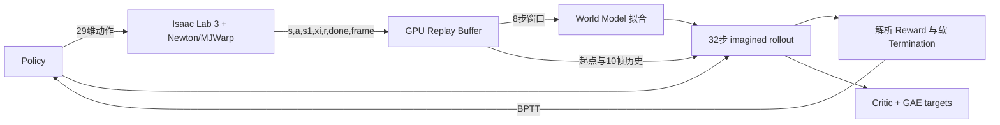

# Phase 0：上游实现与本机环境审计

审计日期：2026-10-26（Asia/Shanghai）  
开发分支：`feature/infantry-world-model`  
Fork/上游共同基线：`a1508d42c9d1699a52e8233ab16d08c488441ab9`  
mjlab 参考基线：`a728959a49a6fa0f1da57f29d77fdbca5aab6257`

## 1. 结论

上游并不是可直接换机器人配置的通用框架。World Model、Replay Buffer、Actor 输出、
运动目标、FK 和环境均把 G1 的 29 DoF 写入代码。训练算法本身可以复用，尤其是多步
World Model 拟合、冻结模型参数的短时域 BPTT、软终止和 Critic bootstrap。

本分支采用旁路适配：保留原 `supermimic/train.py`、`env.py`、`mdp.py`、
`networks.py` 的 G1 行为，新增 `supermimic/core`、`adapters`、`infantry` 和 `data`。
这样 G1 仍可作为回归基线，双轮足代码不要求先重写上游训练程序。

## 2. 上游训练数据流

### World Model

- 状态：`(root p, root R, root v, root w, q, qd)`；内部旋转为 3×3，Buffer 中用
  wxyz 四元数展平，状态宽度 71。
- 输入：航向和平移不变特征 71 + 策略动作 29 + `xi` 33，共 133 维。
- `xi`：摩擦 1、关节零点偏置 29、torso 质心偏置 3。
- 输出：root 局部位置/旋转/线速度/角速度增量各 3，加 29 个关节位置与速度增量，
  共 70 维。
- 网络预测全部状态增量；坐标变换、SO(3) 积分、FK、Observation、Reward 和
  Termination 由解析 Torch 运算完成。
- 训练：Replay Buffer 采样 8 步连续窗口，递归展开后按输出运行标准差归一化误差。

### Actor 与 Critic

- Actor 单帧观测 99 维：`q-q0`、`qd`、机体系角速度、投影重力、上一步动作、
  参考根姿态 6D；使用 10 帧历史。
- Actor goal 是 10 个未来参考帧，每帧 73 维。
- Actor 输出 29 个 G1 关节目标的归一化动作。
- Critic 使用不变完整状态、参考关节/刚体/root 误差、姿态误差、`xi` 和未来目标，
  包含训练时特权信息。

### Reward、Termination 与 Bootstrap

- Reward 是解析动作跟踪奖励，包括刚体位置/姿态/速度、root 位置/姿态、动作变化率
  和软关节限位；每步已乘控制周期。
- 真仿真终止使用高度和倾斜硬阈值；imagined rollout 使用 sigmoid 软终止概率。
- 超时和动作片段结束属于截断，可 bootstrap；训练终止不 bootstrap。
- Critic 使用 imagined transition 上的 GAE(λ) target，BPTT 末端使用 Critic value。

## 3. 梯度链路审计

Actor 更新前，代码把 World Model 和 Critic 参数的 `requires_grad` 设为 `False`，但没有
用 `torch.no_grad()` 包围 `wm.step()`。因此模型权重不积累梯度，模型输出对动作输入的
Jacobian 仍在图中，Reward 可经 World Model 回传到 Actor。

Actor 目标 `J` 在 `loss.backward()` 前没有 `detach()`。`reward` 和软存活概率参与 Actor
梯度；只有用于日志和 Critic target 的副本被 detach。当前路径未发现会切断 Actor 梯度
的原地状态修改。新增测试还对双轮足通用模型执行了自动微分和中心有限差分对照。

风险点：

- 上游 World Model 最后一层零初始化，未训练模型初始时对动作的数值梯度为零；必须先
  完成模型 warm-up，不能把“存在计算图”等同于“已有有用动力学梯度”。
- 解析 Reward 可被不准确 World Model 利用；必须继续保留真 MuJoCo 独立评测。
- 上游 `train.py` 直接固定 `cuda:0`，不能在 CPU 环境运行完整训练。

## 4. Replay Buffer

Buffer 以 `(time, env)` 存储 `s, s1, a, a_prev, xi, reward, frame, episode step,
done`。窗口 mask 会在 episode 边界后置零。它没有保存 observation、command、实际
控制目标、task id 或 terminated/truncated 区分，不足以直接承载现有 Teacher 数据。

本分支的数据格式显式保存上述字段，并按 `episode_id` 做 train/validation/test 划分，
避免相邻窗口跨集合泄漏。

## 5. G1 专属与可复用模块

| 模块 | G1 耦合 | 处理方式 |
| --- | --- | --- |
| `train.py` | 29 DoF、LAFAN1 goal、G1 MDP | 保留为 G1 回归入口 |
| `networks.py` | 输入/输出与 Actor 输出宽度写死 | 新增可配置 `core/networks.py` |
| `mdp.py` | 29 DoF、14 body、跟踪 Reward | 双轮足单独实现任务 Reward |
| `robot.py` | G1 USD、执行器、关节顺序 | 新增 `infantry/spec.py` |
| `kinematics.py` | G1 开链 FK | 闭链机器人不复用该 FK |
| `motion.py` | LAFAN1 CSV 与 G1 FK | Teacher-free 模式不依赖；参考轨迹另建数据集 |
| `buffer.py` | 固定字段与宽度 | 新增语义明确的 chunk 数据集 |
| BPTT/冻结策略 | 算法可复用 | 已抽出到 `core/bptt.py` |
| RunningNorm/MLP | 可复用 | 通用实现保持同一计算方式 |

## 6. mjlab 与 Isaac Lab 3 接口差异

- 现有 mjlab 直接从 `MjSpec` 建实体并在 MuJoCo-Warp 上运行；上游 SuperMimic 先把
  MJCF 离线转换为 USD，再由 Isaac Lab/Newton 生成 articulation view。
- mjlab action manager 原生支持混合位置、速度和 tendon effort；上游 G1 只有统一关节
  位置目标。
- mjlab Manager-Based 环境已定义观测、Reward、事件、随机化和自动 reset；上游环境是
  为 G1 跟踪写的薄封装，不能直接复用这些 manager term。
- 双轮足闭链不能使用上游 G1 的树状解析 FK，也不能用仅含主动关节的状态代替完整状态。

## 7. 本机环境

| 项目 | 实测结果 |
| --- | --- |
| OS | Windows 11，build 26100 |
| GPU | RTX 4060 Laptop，8188 MiB |
| 驱动 | 580.97 |
| WSL | 2.4.13 可用 |
| Docker | 未安装/命令不可用 |
| base Python | 3.14.7，无 PyTorch |
| `mjlab` Conda | Python 3.11.17 |
| PyTorch | 2.14.0+cu130，CUDA 可用 |
| MuJoCo | 3.11.0 |
| Warp | 1.18.0 |

上游固定的 Isaac Lab 3 kit-less Docker 环境尚未构建，因此本轮不能声称已在 Isaac Lab 3
中启动双轮足资产。现有 mjlab CUDA 仿真、Teacher 推理、真实转移采集和通用 World
Model 训练已在本机运行。

## 8. 已执行与未执行

已执行：

- Fork/remote/branch/commit 审计；
- 源 MJCF 编译与结构审计；
- 2 环境 × 3 步的真实 flat Teacher CUDA rollout；
- 通用状态 round-trip、动作/控制语义、episode 窗口和 BPTT 测试；
- World Model 对 control 的有限差分检查；
- 真实采集数据上的 2 步、3 iteration CUDA World Model 冒烟训练。

未执行：

- Isaac Lab 3 kit-less 安装、MJCF→USD 转换和 Newton/MJWarp 双轮足 spawn；
- Isaac Lab 3 闭链/气弹簧一致性轨迹对照；
- 正式规模 Teacher 数据集和 World Model 收敛实验；
- Student Actor 真 MuJoCo 独立评测与 PPO wall-clock benchmark。

## 9. 最小推进顺序

1. 在兼容的 Isaac Lab 3 环境转换资产，确认四个 connect equality 和两个 spatial tendon
   均进入 Newton model。
2. 单环境无控制 reset/step，对比 mjlab 的闭链残差、tendon 长度和自由落体短轨迹。
3. 实现 Isaac Lab Adapter 的 6→8 控制写入并对照固定动作短轨迹。
4. 使用平地 Teacher 扩大数据采集，先训练/验证共享 World Model。
5. 接解析平移 Reward 和 Student BPTT，固定间隔回 mjlab 做独立评测。

